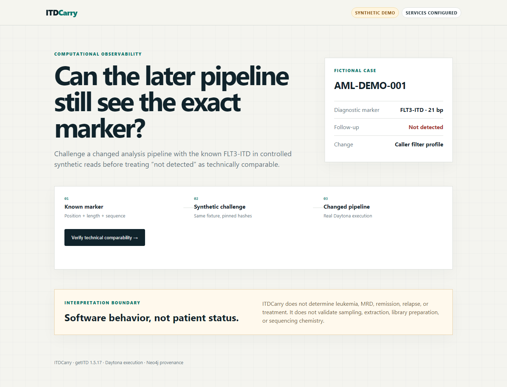

# ITDCarry

[](https://github.com/thinuka-rgb/itdcarry/actions/workflows/ci.yml)



ITDCarry checks whether a later computational pipeline can recover an exact,
previously known FLT3 internal tandem duplication from disclosed synthetic
sequencing reads before a later “not detected” result is treated as technically
comparable.

**Judge summary:** ITDCarry is a computational comparability check for molecular
pathology workflows. It asks whether a changed pipeline can still recover an
exact known marker before a later “not detected” result is treated as technically
comparable.

> Non-clinical proof of concept. ITDCarry does not determine leukemia, MRD,
> remission, relapse, or treatment. It does not validate specimen collection,
> extraction, library preparation, sequencing chemistry, or tissue quality.

## What runs

1. A deterministic generator produces paired 251-bp synthetic reads containing
   a 21-bp FLT3-ITD at getITD amplicon position 72.
2. The same fixture runs through pinned getITD 1.5.17 profiles in Daytona.
3. Python compares position, length, and sequence exactly.
4. Neo4j stores case-marker-pipeline-challenge provenance and returns the verdict.
5. FastAPI serves the API and the single-page demo.

```text
Button → FastAPI → Daytona sandbox → getITD → real TSV
       → exact matcher → Neo4j provenance query → verdict
```

Verdicts:

- `COMPUTATIONALLY_OBSERVABLE`: exact synthetic marker recovered.
- `NOT_TECHNICALLY_COMPARABLE`: execution completed without exact recovery.
- `NO_CONCLUSION`: execution or provenance computation failed.

## Verified fixture

- Fixture: `FLT3-ITD-DEMO-001`
- Sequence: `TTGATTTCAGAGAATATGAAT`
- Length: 21 bp
- Position: 72, getITD one-based amplicon coordinate
- Paired reads: 200 fragments, 251 bp
- Intended synthetic variant-fragment fraction: 0.60
- Seed: `20260912`
- Caller: getITD 1.5.17, commit `d5b80410bdf8dfe00474cd8b51fdf27c5ba0911b`

The compatible profile requires two unique supporting reads and recovers the
marker. The changed profile requires five; the disclosed fixture has four, so
the completed caller run does not produce a high-confidence exact call.

This is the central demonstration: the biological input is unchanged while one
disclosed computational threshold changes the reported result.

## Sponsor responsibilities

| Service | Non-decorative responsibility |
|---|---|
| Daytona | Creates the clean Python sandbox, receives the fixture/caller, executes getITD, and returns the real output plus sandbox identity. |
| Neo4j | Stores case-marker-pipeline-challenge provenance and computes the scoped verdict from graph relationships. |
| GitHub | Hosts the reproducible source, disclosed fixture, versioned profiles, tests, and CI. |

## Setup

```powershell
python -m venv .venv
.\.venv\Scripts\Activate.ps1
python -m pip install -e ".[dev]"
```

Copy `.env.example` to `.env` and set Daytona values. Neo4j Aura credentials can
be stored in ignored `secrets/neo4j.env` using Aura's downloaded format.

Generate fixture:

```powershell
python pipeline/generate_reads.py --reference vendor/getitd/anno/amplicon.txt --output data/synthetic_case/generated
```

Run tests and app:

```powershell
python -m pytest
python -m uvicorn backend.main:app --host 127.0.0.1 --port 8000
```

Open `http://127.0.0.1:8000` and run challenge. One request uses one Daytona
sandbox for both profiles, avoiding repeated setup.

## Frontend handoff

The teammate frontend only needs one request:

```http
POST /api/v1/cases/AML-DEMO-001/handoff-tests
Content-Type: application/json

{"fixture_id":"FLT3-ITD-DEMO-001","profiles":["compatible","changed"]}
```

Set `FRONTEND_ORIGIN` to the frontend URL. Display `verdict`, `runs`, and
`limitations` from the JSON response. Never send Daytona or Neo4j credentials
to the browser.

## Evidence

Each live run creates ignored `artifacts/<run-id>/` folders containing logs,
raw caller output when present, timestamps, and sandbox identity. API exposes
hashes and sandbox IDs without exposing service credentials.

## Sources

- [getITD repository](https://github.com/tjblaette/getitd)
- [getITD publication](https://www.nature.com/articles/s41375-019-0483-z)
- [Daytona Python SDK](https://github.com/daytona/clients/tree/main/sdk-python)
- [Neo4j Python driver](https://neo4j.com/docs/python-manual/current/)

